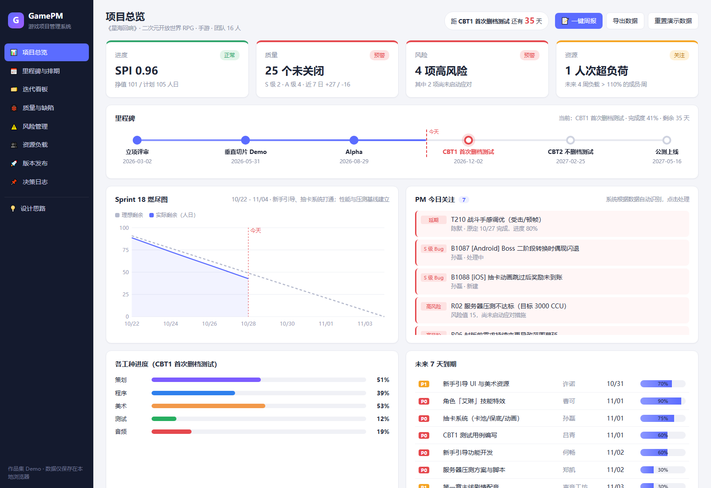

# GamePM · 游戏项目管理系统

> 一个面向**游戏研发项目经理**的"驾驶舱"：把任务、Bug、风险数据加工成可以直接行动的信号。
> 纯前端、零依赖，双击 `index.html` 即可运行。



## 演示场景

虚构项目《星海回响》（二次元开放世界 RPG 手游，16 人团队）已经完成立项、垂直切片和 Alpha，现在处于 **距 CBT1 首次删档测试还有 35 天** 的冲刺阶段。

演示数据以"今天"为基准生成，任何时候打开，项目都处于这个状态。数据里有意埋了一些真实项目中常见的问题，可以在系统中被自动发现：

| 埋下的问题 | 系统如何暴露 |
|---|---|
| 战斗手感调优已延期 | 总览"今日关注" + 甘特图红框 |
| 2 个 S 级 Bug（闪退、付费奖励未到账） | 质量亮红灯，发布门禁不通过 |
| 服务器压测、需求蔓延两项高风险仍在"监控中" | 风险亮红灯，提示需要启动应对 |
| 服务器程序本周负载 123% | 资源热力图 + 自动调配建议（会避开关键路径上的成员） |
| 配音外包的前置关卡配置还没完成 | 依赖阻塞提示 |
| 性能优化 → 封版 → 出包是关键路径 | 甘特图关键路径标记，与风险 R05 呼应 |

## 功能模块

| 模块 | 解决的问题 | 关键设计 |
|---|---|---|
| 📊 项目总览 | 每天早上 5 分钟掌握全局 | 四维健康度红黄绿灯、里程碑时间轴、燃尽图，以及**规则自动生成的"PM 今日关注"** |
| 📅 里程碑与排期 | 哪些任务一延误就会推迟里程碑 | 甘特图、依赖连线，从里程碑倒推**浮动时间 → 关键路径** |
| 🗂️ 迭代看板 | 两周迭代内的执行透明 | 拖拽变更状态；单独设置"**验收中**"列 |
| 🐞 质量与缺陷 | 版本什么时候能封 | S/A/B/C 分级、**Bug 收敛曲线**、模块分布 |
| ⚠️ 风险管理 | 把"担心"变成"预案" | 5×5 概率×影响矩阵；每个风险都有触发条件、应对措施和应急预案 |
| 👥 资源负载 | 谁忙不过来，谁在空等 | 未来 8 周负载热力图，自动生成调配建议 |
| 🚀 版本发布 | 能不能上线 | 由数据**自动判定**质量门禁 + 发布检查清单（合规/技术/内容/运营/渠道）→ Go / No-Go |
| 📌 决策日志 | 当初为什么这么定 | 记录决策的原因和影响 |
| 📝 一键周报 | 向上汇报 | 从数据自动生成结构化周报，可直接复制 |
| 💡 设计思路 | 讲清楚"为什么" | 游戏项目管理的特殊性、指标口径、设计取舍 |

## 面试讲解建议（3-5 分钟）

1. **一句话定位**："任务工具解决的是记录，我想解决的是项目经理每天要回答的三个问题：能不能按时交付、什么会让我们交付不了、现在该做什么决定。"
2. **从总览讲起**：先看四个健康灯，再看"今日关注"。强调这些都是规则从数据里自动识别的，PM 的时间应该花在沟通和决策上。
3. **甘特图讲关键路径**：性能优化 → 封版 → 出包这条链没有缓冲。结合风险 R05（低端机性能），说明自己如何把排期和风险联系起来看。
4. **版本发布讲门禁**：门禁标准在里程碑启动时由团队共同约定，到期由数据判定，Go/No-Go 会议讨论"怎么办"，而不是争论"是不是"。
5. **最后点一下"设计思路"页**，体现对游戏行业的理解：多工种长链路、里程碑驱动、创意不确定性、版号/合规等外部约束。

可能被追问的点：
- **为什么不做工时打卡？** 创意工作按小时管控会伤害信任，人日估算加进度百分比的粒度足够做决策。
- **和 TAPD / 飞书项目是什么关系？** 互补而不是替代。下一步可以通过 API 同步数据，这里是叠加在上面的 PM 视角。
- **SPI 怎么算？** 挣值 EV（按实际进度）÷ 计划值 PV（按计划工期线性分摊）。
- **负载怎么算？** 剩余工作量按剩余工期均摊到每周，再除以周产能（5 人日）。

## 运行与部署

- 本地：双击 `index.html`（推荐 Chrome / Edge）
- 在线展示：把整个目录推到 GitHub，开启 GitHub Pages，就能在简历上放一个可点击的链接
- 修改的数据保存在浏览器 localStorage 中；点"重置演示数据"可以恢复初始状态

## 技术说明

原生 HTML / CSS / JavaScript，无第三方依赖，图表为手写 SVG。

```
index.html        页面骨架
css/style.css     样式
js/data.js        演示数据（以今天为基准生成）
js/app.js         指标计算、页面渲染与交互
screenshots/      各页面截图
```
